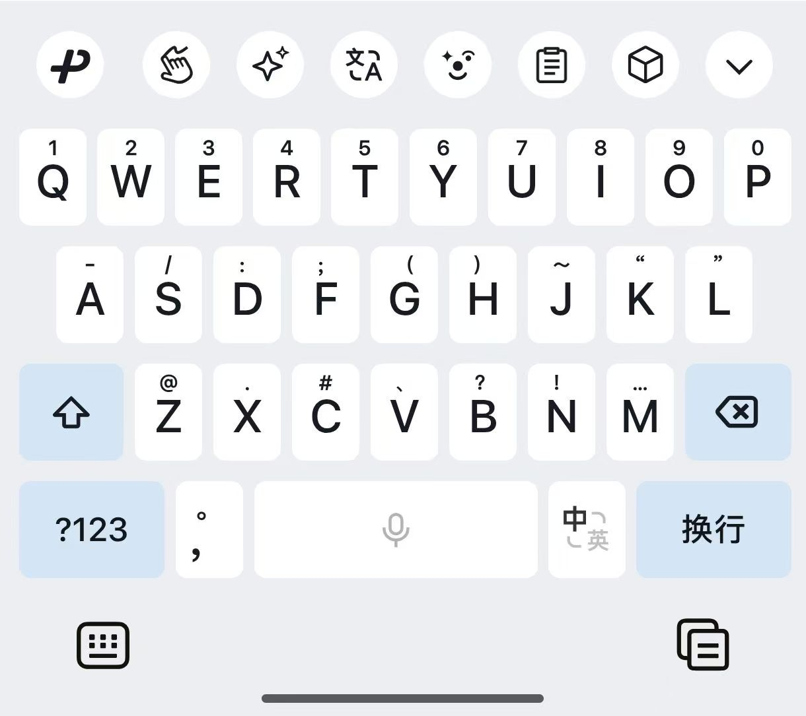
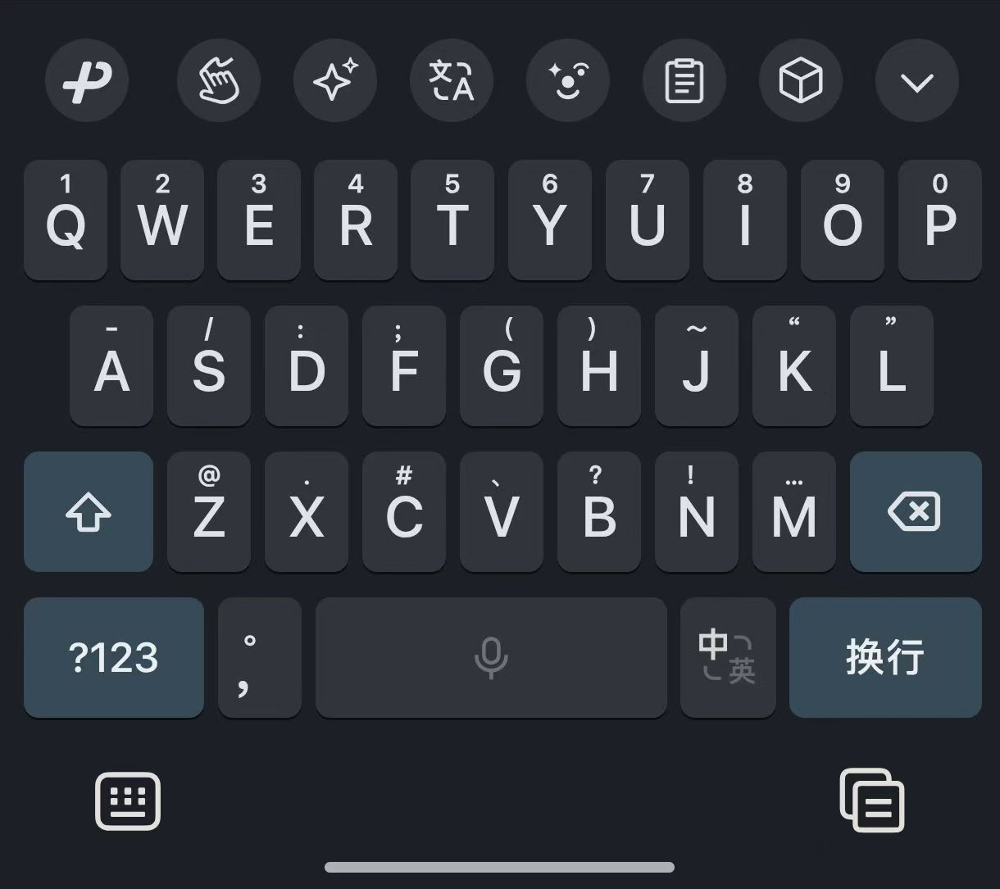

<div align="center">

<h1>WeType Monet</h1>

<p>微信输入法 · Monet 动态配色</p>
<p>为键盘、候选栏和菜单配上系统色彩，提供浅色与深色主题。</p>

<p>
  <a href="https://github.com/0x1e93d/WeType_Monet/releases/latest"></a>
  <a href="https://github.com/0x1e93d/WeType_Monet/releases"></a>
  
  <a href="LICENSE"></a>
</p>

<p>
  <a href="https://github.com/0x1e93d/WeType_Monet/releases/latest">下载</a> ·
  <a href="#效果预览">效果预览</a> ·
  <a href="#安装使用">安装使用</a> ·
  <a href="#常见问题">常见问题</a> ·
  <a href="#开发说明">开发说明</a>
</p>

</div>

## 功能特性

- **系统动态配色**：使用系统 Monet 色彩调整键盘背景、候选词、菜单和部分图标。
- **浅色与深色主题**：分别适配两种模式下的背景、文字和图标颜色。
- **两种安装方式**：提供 Magisk/KernelSU 模块，以及无需 Root 的独立 Monet APK。

## 效果预览

| 浅色模式 | 深色模式 |
| :---: | :---: |
|  |  |

## 安装使用

先根据设备环境选择安装方式，再到 [Releases](https://github.com/0x1e93d/WeType_Monet/releases) 下载对应文件。

| 安装方式 | 使用条件 | 下载文件 |
| :--- | :--- | :--- |
| Magisk/KernelSU 模块 | Android 14 及以上，具备 Magisk 或 KernelSU 环境，已安装官方微信输入法 | `Wetype_Monet_vN.zip` |
| 独立 Monet APK | 无需 Root，首次安装前需卸载官方微信输入法 | `Wetype_Monet_<版本名称>(<版本号>)_vN.apk` |

请核对 Release 中标注的微信输入法版本。同一 Release 同时提供构建时使用的官方原始 APK。

### Magisk/KernelSU 模块

1. 下载 `Wetype_Monet_vN.zip`。
2. 在 Magisk 或 KernelSU 中安装 ZIP。
3. 首次安装完成后重启设备，再打开微信输入法。

KernelSU 动态包还支持以下功能：

| 功能 | 使用说明 |
| :--- | :--- |
| 免重启更新 | 完成首次安装后，后续更新可热安装。成功后重新打开微信输入法；失败时重启设备。 |
| 多用户安装 | 检测到其他用户时，按音量加选择安装，按音量减跳过。选择安装后，重启时为其他用户安装并启用 Overlay。 |
| 启动重试 | Overlay 初始化失败时保留安装状态，下次启动继续尝试。 |

多用户环境中，每个使用主题的用户都需要安装官方微信输入法；选择跳过时，仅为主用户启用主题。

### 独立 Monet APK

独立 APK 保留官方包名 `com.tencent.wetype`，使用公开 LSPatch 签名，不能与官方微信输入法共存。

1. 备份需要保留的输入法数据。
2. 卸载官方微信输入法。
3. 安装 `Wetype_Monet_<版本名称>(<版本号>)_vN.apk`。

后续使用本项目发布的 Monet APK 覆盖更新。

## 下载文件说明

| 文件 | 内容 |
| :--- | :--- |
| `Wetype_Monet_vN.zip` | Magisk/KernelSU Overlay 模块 |
| `Wetype_Monet_<版本名称>(<版本号>)_vN.apk` | 已替换主题资源的独立安装包 |
| `Wetype_<版本名称>(<版本号>).apk` | 官方原始安装包归档 |

`vN` 表示本项目的发布版本，与微信输入法自身的版本分开记录。适配版本、官方更新日志和构建信息可在对应 Release 中查看。

模块在线更新使用 [wetype_monet.json](wetype_monet.json)，更新日志见 [CHANGELOG.md](CHANGELOG.md)。

## 常见问题

<details>
<summary>微信输入法更新后，主题没有生效怎么办？</summary>

官方版本变化时，资源映射也可能变化。先核对已安装的微信输入法版本与模块 Release 标注的版本，再更新对应模块。需要使用构建时的官方版本时，可在同一 Release 下载官方原始 APK。

</details>

<details>
<summary>安装独立 APK 时提示签名冲突怎么办？</summary>

官方 APK 与 Monet APK 的签名不同。先备份数据并卸载当前版本，再安装 Monet APK；从其他来源的修改版切换时，也可能需要先卸载。

</details>

<details>
<summary>如何恢复官方版本？</summary>

- **模块方式**：在 Magisk 或 KernelSU 中停用或卸载模块，然后重启设备。
- **独立 APK**：备份数据，卸载 Monet APK，再安装官方微信输入法。

</details>

## 更新与发布

| 方式 | 触发与行为 |
| :--- | :--- |
| 自动更新 | 每天北京时间 06:17 检查官方 APK，SHA256 变化或缺少有效发布状态时构建发布。 |
| 手动更新 | 运行 [Manual force update](https://github.com/0x1e93d/WeType_Monet/actions/workflows/manual-update.yml)，强制生成并发布新版本。 |
| 测试构建 | 运行 [Test build](https://github.com/0x1e93d/WeType_Monet/actions/workflows/test-build.yml)，强制构建，产物保留一天，不发布。 |

修改主题资源或代码后，通过手动更新发布。在仓库 **Actions → Manual force update → Run workflow** 中，勾选“强制生成新的模块版本”后运行。

自动更新与手动更新共用测试、构建和发布流程，构建前运行 Python 测试及 Python、Shell 语法检查。

测试构建只上传官方 APK、Monet APK 和模块 ZIP，在对应运行记录的 **Artifacts** 中下载。三个工作流复用相同的构建工具链配置。

## 开发说明

<details>
<summary>项目目录与构建脚本</summary>

主题配置、资源文件与发布状态分别存放在以下位置：

| 路径 | 内容 |
| :--- | :--- |
| [config/theme.json](config/theme.json) | 颜色、字符串和 drawable 主题配置 |
| [config/mappings/](config/mappings/) | 各版本的资源名称映射与上游信息 |
| [config/latest.json](config/latest.json) | 发布版本与上游 APK 状态 |
| [assets/drawable/](assets/drawable/) | drawable 源文件 |
| [module_template/](module_template/) | 模块安装和启动脚本 |
| [signing/LSPatch.bks](signing/LSPatch.bks) | 公开发布签名 |
| `out/apk/` | 官方 APK 原包、解包目录和重打包中间文件 |
| `out/overlay/` | 自动生成的 Overlay 清单、资源和 APK |
| `out/module/` | 模块 ZIP 的组装目录 |
| `out/internal/` | 构建元数据与临时签名文件 |
| `out/` 根目录 | 发布用官方 APK、Monet APK 和模块 ZIP |

官方 APK 下载到 `out/apk/official.apk`，解包到 `out/apk/decoded/`。脚本先解析资源映射，再替换解包目录中的主题资源并重打包为 Monet APK。

Overlay 清单由构建脚本生成，和主题资源一起放入 `out/overlay/`。编译签名后，将 Overlay APK 复制到 `out/module/files/`，与模块模板一起打包。

重新解包、生成 Overlay 和组装模块时，会分别重建对应工作目录，避免旧文件残留。`assets/drawable/` 中的源文件独立保留，发布文件名和模块 ZIP 内部结构保持一致。

构建脚本按职责划分：

| 文件 | 职责 |
| :--- | :--- |
| [scripts/build.py](scripts/build.py) | 编排构建流程 |
| [scripts/upstream.py](scripts/upstream.py) | 下载官方 APK，解析版本和更新日志 |
| [scripts/resources.py](scripts/resources.py) | 解析资源映射，生成和替换主题资源 |
| [scripts/packaging.py](scripts/packaging.py) | 查找工具链，打包和签名产物 |
| [scripts/release.py](scripts/release.py) | 管理模块版本、发布状态和更新清单 |
| [scripts/paths.py](scripts/paths.py) | 集中管理项目路径 |

</details>

<details>
<summary>编辑主题配置</summary>

修改 [config/theme.json](config/theme.json)，在 `colors`、`strings`、`drawables` 中以资源原名作为键：

| 类型 | 关键字段 | 用法 |
| :--- | :--- | :--- |
| `colors` | `default`、可选的 `night` | 分别配置默认资源与夜间资源的颜色 |
| `strings` | `value` | 设置文本；空字符串表示清空，未设置该字段时保留原文 |
| `drawables` | `source` | 指向项目内的源文件，使用相对于项目根目录的路径 |

`default` 对应 `values`，`night` 对应 `values-night`。微信输入法的许多深色资源也在 `values` 中，例如 `ime_skin_dark_keyboard_background` 在自己的 `default` 中引用系统深色配色。

条目中可以添加 `description`、`note` 等说明字段，资源生成只使用表中的关键字段。

版本映射由构建脚本生成，保存上游版本、APK SHA256、更新日志和按资源类型划分的“原名 → 混淆名”映射。构建时将映射与当前主题合并使用。

</details>

<details>
<summary>本地构建</summary>

需要 Python 3.11 及以上、Java 17、Android SDK、Apktool 和 Bouncy Castle Provider。工具版本可参考 [自动更新工作流](.github/workflows/auto-update.yml)。

配置 `JAVA_HOME` 和 `ANDROID_HOME`，将 `apktool` 加入 `PATH`，并将 `BCPROV_JAR_PATH` 指向 Provider JAR 文件。

在项目根目录运行：

```shell
python scripts/build.py
```

也可使用 `python -m scripts.build`。需要强制构建时，将环境变量 `FORCE_BUILD` 设为 `true`。

</details>

<details>
<summary>运行测试</summary>

```shell
python -B -m unittest discover -s tests -v
```

测试按模块划分，公共构建样例位于 `tests/build_fixtures.py`。模块脚本测试需要 Bash，使用模拟 Android 命令验证安装和启动流程。

</details>

## 许可证

项目代码采用 [AGPL-3.0](LICENSE) 许可证。
